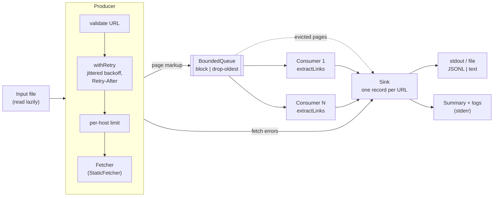

# wle

A concurrent producer/consumer link extractor. The producer fetches the markup of a list of URLs and puts it on a bounded queue. Consumers parse each page as it arrives and output the hyperlinks found on it.

```console
$ cat urls.txt
https://en.wikipedia.org/wiki/Producer%E2%80%93consumer_problem
https://example.invalid/
$ wle --format text --file urls.txt
✓ https://en.wikipedia.org/wiki/Producer%E2%80%93consumer_problem (164 links, 162 ms)
    https://en.wikipedia.org/wiki/Main_Page
    https://en.wikipedia.org/wiki/Wikipedia:Contents
    …
✗ https://example.invalid/
    network: fetch failed: ENOTFOUND
level=warn msg=Failed url=https://example.invalid/ kind=network error="fetch failed: ENOTFOUND" attempts=3
level=info msg=Finished total=2 ok=1 failed=1 errors=network:1 peakQueue=0 p50Ms=162 p95Ms=566
```

## Contents

- [Running it](#running-it)
- [Output](#output)
- [Configuration](#configuration)
- [Architecture](#architecture)
- [How the requirements are met](#how-the-requirements-are-met)
- [Design decisions and trade-offs](#design-decisions-and-trade-offs)
- [Testing](#testing)
- [What I'd do next](#what-id-do-next)

## Running it

Requires Node 26 and pnpm. Node 26 runs TypeScript directly, so there is no build step for local use.

```sh
pnpm install
pnpm start --file urls.txt    # one URL per line; blank lines and # comments skipped
node src/cli.ts --help        # every option (pnpm keeps --help for itself)
```

Each run reads its URLs from one file. Lines are trimmed, blank lines and `#` comments are skipped, and the file is read lazily, so a list of millions of URLs is never held in memory.

With Docker:

```sh
docker build -t wle .
docker run --rm -v "$PWD:/data:ro" wle --file /data/urls.txt
```

Development:

```sh
pnpm test        # 201 tests, about 1 s, no network access
pnpm coverage    # with a coverage report
pnpm lint        # Biome
pnpm typecheck   # tsc --strict
pnpm build       # compile to dist/ (used by the Docker image)
```

## Output

Every input URL produces exactly one record, whatever happens to it. Records go to stdout (or `--out <file>`); logs and the end-of-run summary go to stderr, so piping the output never mixes the two.

Records are written as each URL completes, not in input order, so one slow URL never holds back the others. Each record carries an `inputIndex`, the position of its URL in the input, which identifies the input even when a URL is listed twice; `jq -s 'sort_by(.inputIndex)'` restores input order.

The default format is JSON Lines:

```json
{"inputIndex":0,"url":"https://a.example/","status":"ok","attempts":1,"durationMs":212,"finalUrl":"https://a.example/home","httpStatus":200,"links":["https://a.example/about","mailto:hi@a.example"]}
{"inputIndex":1,"url":"https://b.example/","status":"error","attempts":3,"durationMs":10457,"error":{"kind":"timeout","message":"Timed out after 10000 ms"}}
```

`--format text` gives the human-readable form shown at the top.

| `error.kind` | Meaning | Retried |
|---|---|---|
| `invalid_url` | Not an absolute `http(s)` URL; never fetched | – |
| `network` | DNS failure, refused connection, reset, redirect loop | yes |
| `timeout` | No complete response within `--timeout-ms` (headers *and* body) | yes |
| `http_status` | Non-2xx response; `httpStatus` says which. Only 5xx and 429 are retried | 5xx, 429 |
| `not_html` | `Content-Type` is not `text/html` or `application/xhtml+xml` | no |
| `too_large` | Body larger than `--max-body-bytes`; the download is cut off | no |
| `parse` | The parser threw on this page | no |
| `dropped` | Evicted from a full queue under `--overflow drop-oldest` | no |
| `aborted` | Cut short by Ctrl-C / SIGTERM | no |

Exit codes: `0` every URL succeeded, `2` the run completed but some URLs failed, `1` fatal error (bad arguments or config, or the output could not be written), `130` interrupted.

## Configuration

Every setting can be given as a flag or in a JSON file passed with `--config`. Flags override the file, and the file overrides the defaults. The merged result is validated once against one [zod](https://zod.dev) schema, so a mistake gives a single clear error and exit code 1 before any URL is fetched.

| Setting | Flag | Default |
|---|---|---|
| Fetches in flight, all hosts | `--concurrency` | 16 |
| Fetches in flight, per host | `--per-host-concurrency` | 4 |
| Consumers parsing pages | `--consumers` | 2 |
| Queue capacity (pages) | `--queue-capacity` | 100 |
| Full-queue policy | `--overflow block\|drop-oldest` | `block` |
| Timeout per attempt | `--timeout-ms` | 10000 |
| Largest body | `--max-body-bytes` | 5 MiB |
| Retries after the first attempt | `--retries` | 2 |
| Backoff ceiling, first retry / largest | `--retry-base-delay-ms` / `--retry-max-delay-ms` | 250 / 5000 |
| User-Agent | `--user-agent` | `wle/<version>` |
| Output format / file | `--format jsonl\|text` / `--out` | `jsonl` / stdout |
| Log level | `--log-level`, `-v`, `-q` | `info` |

[`config.schema.json`](config.schema.json) is generated from the zod schema (`pnpm schema`, and a test fails if it goes stale), so editors validate and autocomplete config files. See [`wle.example.json`](wle.example.json).

## Architecture



The core is a library ([`src/index.ts`](src/index.ts)); the CLI is a thin layer over it.

| Module | Responsibility |
|---|---|
| [`queue.ts`](src/queue.ts) | `BoundedQueue<T>`: async FIFO for many producers and consumers, `block` or `drop-oldest` when full, `close()` to signal end of input |
| [`extract.ts`](src/extract.ts) | `extractLinks(html, pageUrl)`: a pure function, the core logic |
| [`fetcher/static.ts`](src/fetcher/static.ts) | One HTTP attempt with timeout, size cap, content-type check and charset decoding, behind the `Fetcher` interface |
| [`retry.ts`](src/retry.ts) | `withRetry`: full-jitter exponential backoff, `Retry-After`, abort-aware; never rejects |
| [`producer.ts`](src/producer.ts) | Reads inputs lazily, fetches under global and per-host limits, puts pages on the queue |
| [`consumer.ts`](src/consumer.ts) | Drains the queue, extracts links, emits records |
| [`pipeline.ts`](src/pipeline.ts) | Wires producer, queue and consumers; owns cancellation and fatal errors |
| [`config.ts`](src/config.ts), [`inputs.ts`](src/inputs.ts), [`output.ts`](src/output.ts), [`logger.ts`](src/logger.ts) | Settings, input sources, record formats, logfmt logging |
| [`main.ts`](src/main.ts) / [`cli.ts`](src/cli.ts) | `main(argv, io) → exit code`, testable with fake streams / process glue: signals and `process.exitCode` |

The fetcher, sink, clock, link extractor and retry sleep are all passed into the pipeline. That is what lets the tests drive concurrency deterministically without a network.

## How the requirements are met

| Requirement | How |
|---|---|
| Producer receives a list of URLs | A file given with `--file`, read lazily, so a list of a million URLs is never held in memory |
| Extracts markup onto a queue | `StaticFetcher` → `BoundedQueue<FetchedItem>` |
| Consumer reads until the queue is empty **and** the producer is done | The producer `close()`s the queue when it finishes. Consumers iterate with `for await`, which ends only once the queue is closed *and* drained, so there is no "empty but not finished yet" race (tested explicitly) |
| Parses HTML and outputs the hyperlinks for each URL | `extractLinks`; one record per URL, to stdout or a file |
| Producer and consumer run concurrently | Both run as concurrent async tasks over the shared queue. A test makes page 2's fetch wait until page 1 has been *parsed and emitted*, which can only finish if they truly overlap |
| Error isolation | Every failure (invalid URL, fetch, HTTP status, parse) becomes a record for that URL only. Tests inject each kind of failure and check the other URLs are unaffected |
| Unit tests | 201 tests: unit, model-based, property-based, local-HTTP integration and real-process tests |
| **Bonus:** URLs fetched concurrently | Global limit (`--concurrency`) plus a per-host limit to be polite to any one server |
| **Bonus:** trim oldest entries when the queue balloons | `--overflow drop-oldest`: a full queue evicts its oldest page, which is reported as a `dropped` record rather than lost silently. The peak queue depth is in the summary |
| **Bonus:** comprehensive tests | About 96% statement coverage; see [Testing](#testing) |
| **Bonus:** other enhancements | Retries with backoff and `Retry-After`; timeouts and body caps; graceful Ctrl-C; config file plus JSON Schema; JSONL output; exit codes; Docker; CI |

## Design decisions and trade-offs

**TypeScript on Node rather than the JVM.** The team uses the JVM; I know TypeScript well and the JVM not at all. I'd rather show sound concurrency design in a language I'm fluent in than write poor Java. The ideas carry over directly: `BoundedQueue` is roughly an `ArrayBlockingQueue` with an eviction policy, the producer's limits do the job of a bounded executor, and an `AbortSignal` plays the role of a cancellation token.

**Why the queue is hand-written.** I looked for a library first. The concurrency limiters (`p-limit`, `p-queue`) solve a different problem. The async channel libraries are small, and none offer a close-then-drain lifecycle together with a drop-oldest policy. Effect's `Queue.sliding` does, but it would have meant rewriting the whole program in Effect's style. The queue is about 170 lines. Because it is the riskiest code here, it has a model-based test that runs random operation sequences against a naive reference model. `p-limit` is still used for the per-host limits.

**Backpressure by default, eviction on request.** The brief asks to trim the oldest entries when the queue grows too large. Silently losing data is usually the wrong default, so `block` is the default: a full queue makes the producer wait, which stops new fetches. `drop-oldest` is one flag away. When it evicts a page, that page is still reported as a `dropped` record and counted in the summary, so nothing disappears without a trace.

**Exactly one record per input.** This is the invariant that makes error isolation checkable: you can compare the record count with the input count. It holds for evicted pages, for inputs rejected before fetching, and for URLs cut short by Ctrl-C. That includes the awkward case of an input read just as the interrupt arrives.

**Parsing on the main thread, not in worker threads.** Node runs JavaScript on one thread, so parsing (CPU-bound) and fetching (I/O-bound) share it. For normal pages the network dominates. A parse takes a millisecond or two, while a fetch takes tens to hundreds of milliseconds. Consumers yield to the event loop after every page, so a backlog never stalls fetching. If profiling showed parsing was the bottleneck, I would move consumers onto `worker_threads` behind the same queue. I didn't add that complexity speculatively.

**Retries.** Network errors, timeouts, 5xx and 429 are retried, with "full jitter" backoff (a random delay up to an exponentially growing ceiling) so that many failing URLs don't retry in lockstep. `Retry-After` is honoured exactly. If it asks for longer than `--retry-max-delay-ms`, the URL gives up rather than stalling the run. A URL holds its per-host slot only while it is actually fetching, not while it backs off.

**Timeouts and limits.** The timeout covers reading the body as well as receiving the headers, so a server that trickles bytes forever still times out. The body cap is enforced while streaming, so a huge response is cut off rather than downloaded in full.

**Failure modes of the tool itself.** If output cannot be written (disk full), the run aborts with exit code 1. A naive version would deadlock here: a producer blocked on a full queue that no consumer drains any more. The pipeline aborts the run and drains the queue so everything can finish. `wle … | head` exits quietly when the pipe closes. The first Ctrl-C finishes gracefully and still writes every record and the summary; a second Ctrl-C quits immediately.

**Link rules** (my assumptions where the brief is open):

- Only `<a href>` counts as a hyperlink. Not `<link>`, `<area>`, `` and so on.
- Links are resolved to absolute URLs against the first `<base href>`, or else against the final URL after redirects.
- Fragments are stripped, and duplicates removed keeping first-seen order.
- `mailto:` and `tel:` links are kept. `javascript:`, `data:` and `vbscript:` links are dropped, as are empty, fragment-only and unparseable hrefs.
- Error pages (4xx/5xx) are not parsed for links.

### Deliberately out of scope

- **JavaScript-rendered pages (SPAs).** The static fetcher returns raw HTML, so a client-rendered app shows up as `<div id="root">` with no links. Rendering with Playwright would fix that, at the cost of roughly 300 MB of browsers, seconds and around 100 MB of memory per page, and new failure modes. The `Fetcher` interface ([`fetcher/types.ts`](src/fetcher/types.ts)) is the extension point: a `PlaywrightFetcher` would slot in without changing the pipeline. In a real deployment I would add it as an opt-in `--renderer=playwright` with its own image tag. A further step would re-render automatically when a static fetch looks like an empty SPA shell.
- **robots.txt.** Not consulted. Fine for a list of URLs given by the user, but required before this became a crawler.
- **Charset sniffing.** The `Content-Type` charset is honoured, with UTF-8 as the fallback. `<meta charset>` sniffing isn't done.
- **A missing `Content-Type`** is treated as HTML rather than rejected.
- **Head-of-line blocking across hosts.** The producer reads at most `--concurrency` inputs ahead. A long run of URLs for one host can therefore fill that window while waiting for its per-host slots, leaving other hosts idle. The fix is a scheduler with a ready queue per host; it wasn't worth the complexity for this exercise.

## Testing

`pnpm test` runs 201 tests in about a second, with no access to the internet. Statement coverage is about 96%. `cli.ts` shows as 0% because it is tested by spawning a real process, which coverage doesn't track. No coverage threshold is enforced.

| Kind | What | Where |
|---|---|---|
| Unit | Queue semantics: ordering, both overflow policies, close and drain, fairness, falsy items | [`queue.test.ts`](test/queue.test.ts) |
| Model-based (fast-check) | Random sequences of put/take/close compared step by step with a naive array model, 500 runs | [`queue.model.test.ts`](test/queue.model.test.ts) |
| Example-based | About 30 tricky HTML cases: `<base>`, entities, protocol-relative URLs, IDN, links inside scripts and comments, unclosed tags | [`extract.test.ts`](test/extract.test.ts) |
| Property-based (fast-check) | For generated documents, every link is absolute, fragment-free and unique; extraction is idempotent; arbitrary input never throws | [`extract.test.ts`](test/extract.test.ts) |
| Integration | Static fetcher against a local HTTP server with slow, hanging, 4xx/5xx, redirecting, looping, binary, oversized and wrongly-encoded routes | [`fetcher.static.test.ts`](test/fetcher.static.test.ts) |
| Concurrency and isolation | Producer/consumer overlap; global and per-host limits; lazy input; 300 URLs with failures and every record accounted for; drop-oldest; cancellation; a failing sink with a full queue doesn't hang | [`pipeline.test.ts`](test/pipeline.test.ts) |
| CLI | Exit codes, config precedence, the input file, usage errors, output errors, closed pipe, interrupts | [`main.test.ts`](test/main.test.ts) |
| Real process | Graceful SIGINT flushes records and exits 130; a second SIGINT quits immediately | [`cli.test.ts`](test/cli.test.ts) |

**Testing the tests.** I checked that the generated tests catch real bugs by planting them by hand. Disabling the handover of a waiting put, or an off-by-one in capacity, makes the model-based queue test fail with a 2–3 step counterexample. Removing fragment stripping or de-duplication makes the link property tests fail. Removing the whitespace trim does *not* break the property tests, because `URL` trims whitespace itself. It is caught by the example tests instead (`"   "` and `" #x"`). That's why both kinds of test are there: properties check rules that must always hold, and examples pin down the specific edge cases.

The test suite was run repeatedly to check for flakiness. Timing-dependent tests use short local timeouts and avoid tight sleeps.

## What I'd do next

- An opt-in Playwright fetcher for SPAs, as described above.
- `robots.txt` and per-host rate limiting (requests per second, not just concurrency), if this grew into a crawler.
- Moving parsing to `worker_threads`, if profiling ever showed parsing was the bottleneck.
- Metrics such as a Prometheus endpoint or OpenTelemetry spans, for long-running use.

See [`PLAN.md`](PLAN.md) for the design as agreed before coding, and [`AI_NOTES.md`](AI_NOTES.md) for how AI was used.
